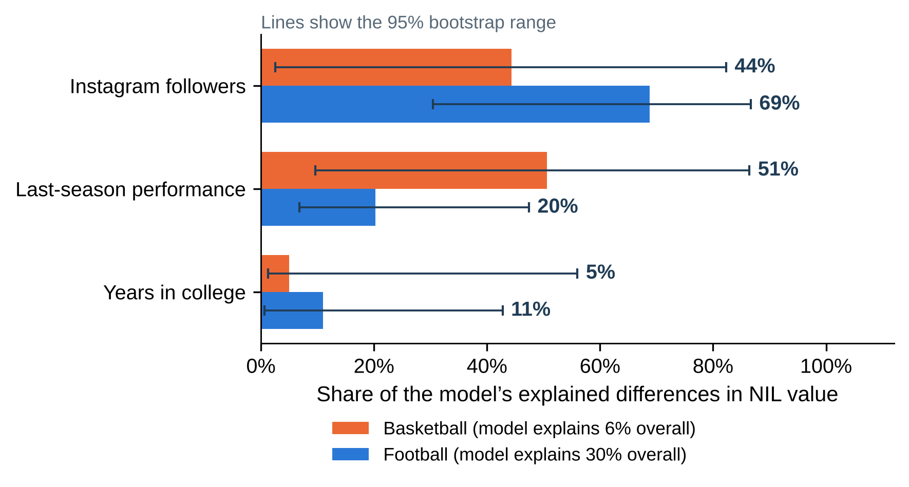
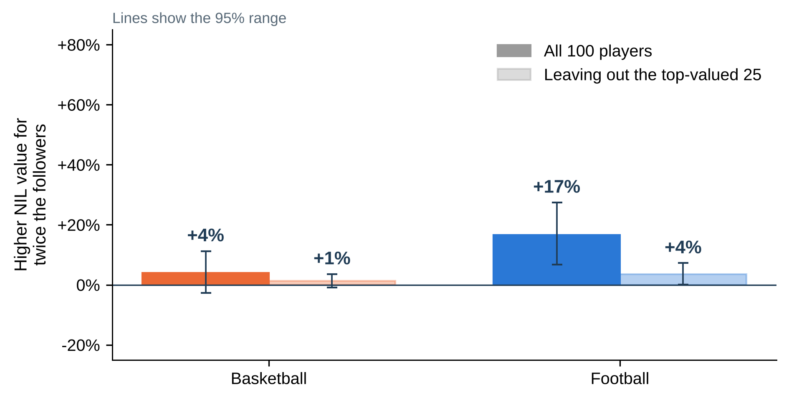
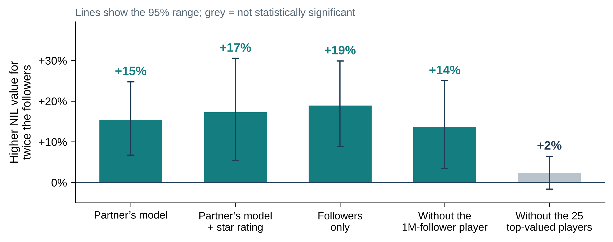
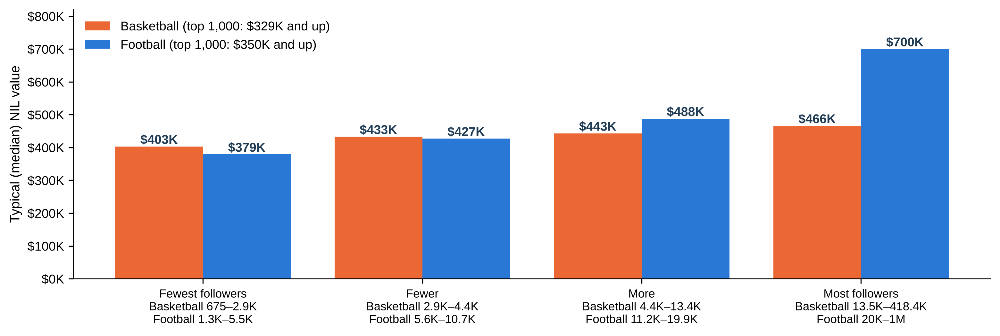
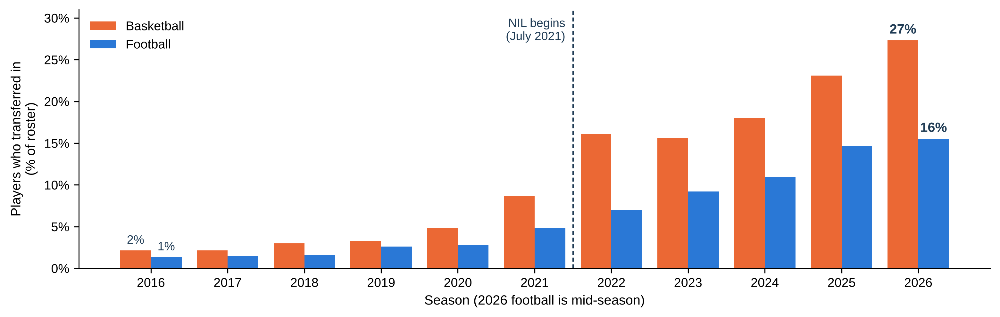

# Social media following and college athlete NIL valuation

Rahul Govil and Sam Teshome
AIPI 510 Module Project 2  |  November 3, 2026

## Abstract

Name, image and likeness (NIL) rules now let college athletes earn money from their personal brand, and published NIL valuations are widely quoted. We asked how strongly an athlete's Instagram following is associated with that valuation, and whether the association looks the same in men's basketball and in football. We sampled both sports the same way: 100 players per sport, drawn at random from the 1,000 highest valuations on The Sideline NIL tracker, so every player in either sample is valued at roughly $330,000 or more. Our main model applies one ordinary least squares formula to each sport separately: log valuation on log followers, last-season performance and years in college, with HC3 robust standard errors. In football, doubling a player's followers was associated with about 17% higher valuation (95% CI 7% to 27%, p < 0.001), and followers accounted for about two thirds of the variation the model explained. In basketball the association was small and not statistically significant: +4% per doubling (95% CI -3% to 11%, p = 0.25), and the model explained only 6% of the variation. The two slopes differ at the 0.05 level (p = 0.044) but not at our Bonferroni-adjusted level of 0.0167. We also fitted a separate model for each sport using variables only that sport has. In football, adding recruiting stars, freshman status and position gave a similar 21% per doubling (p = 0.003). In basketball, players in the five largest conferences were valued about 24% higher (p = 0.005), while followers stayed non-significant. The football association is concentrated among the highest-valued players, and the data are a single snapshot, so the results describe association rather than cause.

## Background and Motivation

The NCAA adopted an interim NIL policy on July 1, 2021 [1]. Since then, athletes have been able to sign endorsement and sponsorship deals, and several companies now publish estimated NIL values for thousands of players. Those estimates matter beyond curiosity. Recruits and families use them to compare offers, collectives use them to set budgets, and the public uses them to judge whether money is following athletic merit or attention.

Our question sits in the middle of that debate. If valuations mostly track social media reach, then the NIL market rewards audience size, which is only loosely connected to on-field ability. If they mostly track performance and experience, the market looks more like a traditional talent market. We cannot settle which mechanism drives the pattern, but we can measure how large the follower association is, how it compares with the performance measures available to us, and whether it differs between a small-roster sport (basketball, about 14 players per team) and a large-roster sport (FBS football, about 115). An NIL estimate is not a verified payment or a scholarship decision, and we treat it throughout as a published market estimate.

## Null and Alternative Hypotheses

We tested three pre-specified hypotheses about the follower coefficient β, the change in log valuation per one-unit change in ln(1 + followers):

|  | Null hypothesis | Alternative hypothesis | Result |
| --- | --- | --- | --- |
| H1 Football | β football = 0 | β football ≠ 0 | Rejected (p = 0.0007) |
| H2 Basketball | β basketball = 0 | β basketball ≠ 0 | Not rejected (p = 0.25) |
| H3 Sport difference | β basketball − β football = 0 | The two slopes differ | Not rejected at 0.0167 (p = 0.044) |

All three are tested with the main model, and all three tests are two-sided. Because they form one family, we used a Bonferroni-adjusted significance level of 0.05 / 3 = 0.0167. The original project proposal also asked whether the follower association changed after NIL began (H0: the follower-by-post-2021 interaction equals zero). We could not test that hypothesis, because follower counts from before 2021 and a common outcome measured in both eras are not available. We return to this in the Limitations section.

## Description of Experimental Design

This is an observational study of secondary data, not a controlled experiment. We did not assign followers, NIL access or any treatment, so the design identifies associations rather than causal effects.

| Element | How it is handled in this study |
| --- | --- |
| Dependent variable | Natural log of the published NIL valuation in US dollars |
| Independent variable of interest | Natural log of 1 + Instagram followers |
| Covariates (main model, both sports) | Last-season performance percentile within sport; flag for no college statistics last season; years in college |
| Covariates (sport-specific models) | Football: centered recruiting stars, freshman, stars × freshman, four position groups. Basketball: points per game, freshman, big conference, forward or center |
| Control conditions | No untreated control group exists. Comparison comes from players with fewer followers within the same sport, from the second sport, and from a refit without the 25 highest-valued players |
| Randomization | Stratified random sampling with seed 510; no random assignment of exposure |

Football. The partner sample draws 100 players from the 1,000 highest football valuations: 25 from the lowest tier, 50 from the middle tier and 25 from the highest tier, using seed 510. Because rounded valuations tie, the tiers hold 266, 479 and 255 players, so the selection probabilities are 25/266, 50/479 and 25/255, close to proportional. Every sampled football player is valued at $350,000 or more, and 99 of the 100 play in a Power 4 conference. We reran the original script and reproduced all 100 players in the same order.

Basketball. We collected the full Sideline basketball listing (5,348 players, retrieved November 2, 2026) and kept the 1,000 highest valuations, the same population used for football. We split those 1,000 into four equal quarters by NIL rank (250 each) and drew 25 players at random from each quarter with seed 510, so every player had the same selection probability of 0.1. The four quarters run from $329,000 to $368,000, $369,000 to $434,000, $443,000 to $549,000 and $552,000 to $6 million. The sample was frozen before any follower counts were looked up, so the choice of players could not depend on how easy their accounts were to find, and no player was replaced to improve coverage. An earlier draw from all 5,348 listings is kept in the repository for provenance only and is not used in any result.

Both samples now come from the top 1,000 valuations of their sport and cover a similar price range ($329,000 and up for basketball, $350,000 and up for football), so valuations can be compared across sports. The football draw used three tiers and the basketball draw four quarters, so the designs are close but not identical; we therefore compare follower slopes within each sport and do not estimate a sport main effect.

## Power Analysis

The partner calculation assumed overall R squared 0.35 and used overall Cohen f squared equal to 0.35 divided by 0.65 or 0.538. Its reported 41 and 46 player requirements concern overall model fit. They do not justify power for one social coefficient or a social by sport interaction. A model can explain substantial variation through other predictors while the social term adds little information.

We therefore evaluated one added term using partial f squared equal to the difference between full and reduced R squared divided by one minus full R squared. The planning calculation uses a noncentral F distribution with numerator degrees of freedom 1, denominator N minus p minus 1, and noncentrality N times partial f squared. We use eight predictor degrees of freedom excluding the intercept, alpha 0.0167, and target power 0.80. The SciPy based implementation searches integer sample sizes [2].

| Assumed partial f squared | Required N | Power at N equals 100 |
| --- | --- | --- |
| 0.02 | 527 | 0.158 |
| 0.05 | 213 | 0.423 |
| 0.15 | 74 | 0.922 |

These are sensitivity scenarios rather than estimates of a true effect. The approximation assumes independent homoskedastic errors and a specified design. It is not the power of our HC3 or clustered Wald tests. School and athlete dependence, missingness, unequal selection, measurement error, and additional interaction parameters can increase the required sample. A 1000 player target offers collection capacity but does not by itself establish power for the planned comparison. We do not calculate retrospective observed power as evidence for the reported result.

## Data Collection and Cleaning Procedures

Football. The football data come from the partner collection, which attributes NIL values to The Sideline [3] and adds Instagram followers, recruiting stars, position, class and PPA per play from public sources. We kept the inherited CSV files unchanged and recorded their SHA-256 hashes. The audit found 41 players with a PPA value of exactly zero and 30 nonzero PPA values for linemen and defenders, for whom an offensive per-play metric does not apply. We therefore treat zero PPA as missing, use PPA only in the replication model and the main model, and leave it out of the football-specific model.

Basketball. A Safari collection script expanded every public page of the Sideline basketball ranking and saved 108 hashed page snapshots (no login, private API or security workaround). After the sample was frozen, each player was searched on Google as name + school + instagram and the first Instagram result was opened. When that result was a team or school post, the athlete was identified through their tag on the post; irrelevant results were rejected rather than counted. Ninety-nine exact follower counts were read from public profiles in the browser on November 3, 2026, and Sam supplied the one remaining count, which is labelled user_reported in the data. Refitting the main model without that player gives the same result (+4% per doubling, p = 0.24). Last-season points per game (2025 to 2026) came from ESPN box scores via SportsDataverse [4], matched by ESPN athlete ID, or by an exact unique name match at the listed school when no ID was available. Where a player was listed on two teams after a mid-season move, we kept the team where they played the most games. One player with no listed class year was given the sample median.

Shared cleaning rules. Missing values were never filled with zero. Players with no college statistics last season (30 in basketball and 41 in football, mostly freshmen and players new to Division I) were kept and flagged rather than dropped. Performance was converted to a 0 to 100 percentile within each sport so the two sports are on a common scale. We did not infer race or any other demographic attribute from names or photos.

Raw and cleaned data. Raw inputs are Data/football_top1000.csv, Data/football_sample_100.csv and the partner's enriched file; for basketball, the top-1,000 extract, frozen sample, Google lookup receipts, identity reviews and follower-count receipts under replication/basketball_top1000/, plus the full listing and page snapshots under Data/private/ (kept local because of size and source terms). Cleaned analysis files are Data/football_modeling_data.csv, Data/curated/basketball_top1000_nil_frame.csv (the 1,000-player frame) and Data/curated/basketball_top1000_instagram_100.csv (the 100-player analysis sample). Supporting roster frames used for the transfer trend are summarized below.

| Source frame | Rows | Distinct athletes | Schools |
| --- | --- | --- | --- |
| Basketball 2018 to 2019 | 5590 | 5562 | 353 |
| Basketball 2019 to 2020 | 5587 | 5575 | 353 |
| Basketball 2025 to 2026 | 5680 | 5677 | 365 |
| Football fall 2018 | 23755 | 23751 | 216 |
| Football fall 2019 | 23985 | 23966 | 217 |
| Football fall 2025 | 26327 | 26316 | 234 |
| Football fall 2026 (in progress) | 26094 | 26092 | 235 |

## Statistical Analysis

### Choice of test and rationale

NIL values and follower counts are both strongly right-skewed, so we modelled the natural log of valuation against ln(1 + followers). On this scale the follower coefficient converts directly to a percentage: doubling followers multiplies valuation by 2^β, so the effect size we report is 100 × (2^β − 1) percent. We used ordinary least squares with HC3 heteroskedasticity-robust standard errors because the residual spread is uneven (see assumption checks below), and HC3 is the most conservative of the standard corrections at n = 100. Each coefficient was tested with a two-sided Wald test.

Main model. To compare the sports on equal terms, we fitted the same formula to each sport separately (two regressions, 100 players each):

ln(NIL) = b0 + β·ln(1 + followers) + b1·performance percentile + b2·no-stats flag + b3·years in college + error

H3 was tested with a pooled model that adds a sport indicator and its interaction with each predictor, again with HC3 errors. To show which factor matters most, we split each model's R² among followers, performance and years in college with general dominance analysis, which averages each factor's added R² over every order in which it could enter, and bootstrapped this 1,000 times for 95% intervals. Sport-specific models. The main model can only use variables measured in both sports, so we also fitted one model per sport that adds what only that sport has. The football model adds centered recruiting stars, freshman status, their interaction and four position groups, and drops the unverified PPA measure and the near-constant conference indicator (99 of 100 football players are Power 4). The basketball model adds points per game (per 5 points), freshman status, membership in the five largest conferences (ACC, Big Ten, Big 12, SEC, Big East) and a forward-or-center indicator. Football robustness checks (the partner's original model, dropping the largest account, and school-clustered errors) are reported as supplementary.

### Results: main model (same formula in each sport)

|  | Basketball | Football |
| --- | --- | --- |
| N | 100 | 100 |
| Follower β (95% CI) | 0.057 (-0.040 to 0.153) | 0.221 (0.093 to 0.350) |
| p value | 0.248 | 0.0007 |
| Effect per doubling of followers | +4% (-3% to 11%) | +17% (7% to 27%) |
| Partial f² for followers | 0.02 | 0.25 |
| Model R² (adjusted) | 0.06 (0.02) | 0.30 (0.27) |
| Share of explained R²: followers | 44% (3 to 82) | 69% (30 to 87) |
| Share: last-season performance | 51% | 20% |
| Share: years in college | 5% | 11% |
| Without the top 25 players | +1% (p = 0.25) | +4% (p = 0.05) |

The football follower slope is well below the 0.0167 threshold, so we reject H1. The basketball slope is small and not significant (p = 0.25), so we do not reject H2; its partial f² of 0.02 is below Cohen's small-effect benchmark, against 0.25 (a medium effect) in football. The pooled interaction test gives p = 0.044 for the difference between the slopes. That is below 0.05 but above our Bonferroni-adjusted 0.0167, so we do not formally reject H3, although the evidence leans toward a weaker follower association in basketball. Performance was borderline in football (p = 0.049) and not significant in basketball (p = 0.26); years in college was not significant in either sport. In basketball the model as a whole explains only 6% of the variation (adjusted R² 0.02), so the dominance shares there divide a very small amount and their intervals are wide.

Figure 1. Share of the model's explained variation in NIL value contributed by each factor, same model in both sports. Lines show 95% bootstrap ranges. The basketball model explains only 6% of the variation, so its shares are imprecise.

Figure 2. Higher NIL value for twice the followers, with all 100 players and without the 25 highest-valued players. Lines show 95% confidence intervals.

### Results: sport-specific models

Football-specific model. Adding recruiting stars, freshman status and position barely changes the football follower effect.

| Football model | N | β | 95% CI | p | R² |
| --- | --- | --- | --- | --- | --- |
| Football-specific (position groups, HC3) | 100 | 0.274 | 0.094 to 0.454 | 0.0028 | 0.355 |
| Supplementary: partner replication (HC3) | 100 | 0.207 | 0.079 to 0.335 | 0.0015 | 0.321 |
| Supplementary: replication, largest account removed | 99 | 0.212 | 0.068 to 0.355 | 0.0039 | 0.306 |
| Supplementary: school-clustered errors | 100 | 0.274 | 0.121 to 0.427 | 0.0009 | 0.355 |

In the football-specific model, doubling followers goes with 20.9% higher valuation (95% CI 6.7% to 37.0%), close to the 17% from the main model. The partner's original model gives 15.4%. All four football fits are positive and significant at 0.0167, so the football result does not hinge on one modelling choice or on the one player with more than a million followers. We did not choose a model by its p value or R².

Figure 3. Football (supplementary): higher NIL value for twice the followers under different model choices. Lines show 95% confidence intervals; grey means not significant.

Basketball-specific model. Adding points per game, freshman status, conference and position raises the share of variation explained from 6% to 11%.

| Basketball term | Effect on NIL value | 95% CI | p |
| --- | --- | --- | --- |
| Twice the followers | +4% | -3% to +11% | 0.243 |
| +5 points per game | +5% | -8% to +19% | 0.480 |
| Freshman | -5% | -22% to +16% | 0.626 |
| Big conference (ACC, Big Ten, Big 12, SEC, Big East) | +24% | +7% to +44% | 0.005 |
| Forward or center (vs guard) | +19% | -5% to +50% | 0.133 |

Players in the five largest conferences (84 of 100) are valued about 24% higher than otherwise similar players (p = 0.005; median $465K against $360K). This is the only clear factor in the basketball model. The follower effect is unchanged at +4% per doubling (β = 0.057, 95% CI -0.038 to 0.152, p = 0.24), and points per game, freshman status and position show no clear effect. Among top-valued basketball players, then, where a player plays matters more than how many followers they have. Football could not be checked the same way because nearly every sampled football player is in a Power 4 conference.

### Assumption checks

Linearity and influence were checked with residual plots, leverage and Cook's distance. Heteroskedasticity was tested with the Breusch–Pagan test (main model: basketball p = 0.034, football p = 0.0054; football-specific model p = 0.0004), which is why we used HC3 errors throughout. Residual normality was rejected by Jarque–Bera in both sports (basketball p = 1.4 × 10⁻¹¹⁹, football p = 5.7 × 10⁻¹¹), mainly because of a few very high valuations; basketball's top listing is $6 million against a median of about $440,000. With n = 100 and robust errors this mostly affects precision rather than bias, but it is one reason we also report the rank-based tests below. Multicollinearity is low: the largest variance inflation factor is 2.4 in basketball, 2.4 in football and 1.5 in the football-specific model. 7 basketball and 8 football players have Cook's distance above 4/n, and no leverage exceeds 0.20; we kept them, since they are real valuations rather than errors. Independence is the weakest assumption, because players from the same school share a market. The school-clustered football fit (39 schools, supplementary) gives a slightly narrower interval, so clustering does not change the conclusion.

### Post hoc tests

As a check that does not rely on the log-linear form, we split each sport into four equal follower groups and compared valuations with a Kruskal–Wallis test, followed by pairwise Mann–Whitney tests with Holm correction. In football, valuations differed clearly across follower groups (H = 24.3, p < 0.001, ε² = 0.25): the highest group differs from the two lowest (p < 0.001 and p = 0.011) and the lowest differs from the second-highest (p = 0.012). In basketball they did not (H = 2.2, p = 0.54, ε² = 0.02), and no pair survives correction. This matches the regression: in football the gap is mostly between the most-followed players and everyone else, and in basketball there is no clear gap.

The partner's draft also compared football valuations by recruiting stars. A Kruskal–Wallis test shows the star groups differ (H = 13.4, p = 0.001, ε² = 0.14), but the Holm-corrected pairs show the difference is 5-star versus 4-star only (p = 0.002); 3-star players (median $500K) were not valued below 4-star players (median $438K). There are only 13 five-star and 17 three-star players, so these comparisons are imprecise.

Figure 4. Median NIL value for four equal follower groups in each sport. Both sports were sampled from their top 1,000 valuations, so bar heights can be compared across sports.

Transfers. As context, the share of each season's roster made up of players who transferred in rose from 2% in 2016 to 27% in 2026 in basketball, and from 1% to 16% in football over the same years (Figure 5). NIL arrived at the same time as the one-time transfer exception, so this trend cannot be attributed to NIL alone, and we did not test it formally.

Figure 5. Share of each season's roster made up of players who transferred in, Division I men's basketball (orange) and FBS football (blue). The 2026 football season is in progress.

## Interpretation of Results

With both sports sampled from the top of their markets, Instagram following is clearly linked to NIL value in football but not in basketball. In football, doubling a player's followers goes with about 17% higher NIL value, and followers account for about two thirds of what the model explains, well ahead of performance and years in college. In practical terms, two football players with the same performance and class year, one with 10,000 followers and one with 20,000, would be expected to differ by about a sixth in published valuation. In basketball the same comparison gives only about 4%, which we cannot distinguish from zero.

The sport-specific models agree. In football the follower effect holds after adding recruiting stars and position (21% per doubling). In basketball the clearest factor is conference: players in the five largest conferences are valued about 24% higher, while followers add nothing measurable.

Three further features limit how far the results go. First, the football effect lives at the top of the market. Once the 25 highest-valued players are removed, the football slope falls to about 4% per doubling, and the post hoc tests show the same pattern: followers mainly separate the most valuable football players from everyone else. Second, the main model explains only 6% (basketball) to 30% (football) of the variation in log valuation, so most of what drives NIL estimates is not captured by the variables available in both sports. Third, the gap between the sports is suggestive (p = 0.044) but does not pass our multiple-testing threshold, so we describe it as a likely difference rather than an established one.

The pattern is consistent with three explanations that our data cannot separate: followers attract sponsors and raise value; fame from playing well drives both followers and valuation; or the valuation provider uses follower counts in its formula, which would build the association into the outcome.

## Limitations

Observational, single-snapshot design. Followers and valuations were measured at about the same time, so we cannot say which comes first, and we cannot show valuations changing over time. The before-and-after NIL question in the original proposal could not be tested because pre-2021 follower counts and a common outcome do not exist in our data.

Selected samples. Both sports were sampled only from their 1,000 highest valuations, which restricts the range of the outcome and may shrink both slopes; the results describe the top of each market, not the typical college athlete. The football and basketball draws used slightly different tiers (three for football, four for basketball), which is one reason sport was not tested as a main effect.

Measurement. The Sideline does not publish its valuation method, rounds its values (only 235 distinct values among the top 1,000 football players), and may use follower counts as an input. One basketball follower count was reported manually and has no exact measurement date; removing it does not change the result. Basketball accounts were found by a Google search and checked against name and school, which is source-based review rather than a guarantee of ownership. Football PPA has unverified values, and points per game is a rough performance measure for basketball. No defensive or position-appropriate football metric was available.

Statistical. With 100 players per sport the cross-sport comparison is underpowered (see Power Analysis), residuals are not normal in either sport, and players at the same school are not fully independent. The Bonferroni threshold protects against false positives across the three tests but makes H3 harder to detect.

## Conclusion and Recommendations

Sampling both sports the same way, from the 1,000 highest valuations, and using one formula in both, Instagram following is clearly and positively associated with published NIL valuation in football but not in men's basketball. In football the association outweighs the performance and experience measures, holds after adding recruiting stars and position, and is driven by the highest-valued players. In basketball the follower association is small and not significant, and the clearest factor is whether a player is in one of the five largest conferences. These findings describe how the current NIL market values top athletes; they do not show that followers cause higher value or that NIL changed recruiting.

For anyone building on this work, we recommend: (1) sampling both sports across their full NIL range, not only the top 1,000, to see whether the football pattern holds for typical players and whether basketball followers matter lower in the market; (2) recording follower counts with dates at regular intervals, which would allow a test of whether follower growth comes before valuation growth; (3) obtaining or documenting the valuation method, to rule out followers being an input; (4) adding team and conference measures to the main model for basketball, and collecting a football sample outside Power 4 so the conference finding can be checked in both sports; (5) adding position-appropriate performance measures for football and a richer measure than points per game for basketball; and (6) for the policy question, collecting a common outcome, such as offers or roster spots, in both the pre- and post-2021 eras.

## References

[1] NCAA. "The History of the NCAA." June 30, 2021 entry: interim NIL policy effective July 1, 2021. https://www.ncaa.org/about-us/history/ (accessed November 1, 2026).

[2] Govil, R. and Teshome, S. AIPI 510 Project 2 repository: collection, cleaning and analysis scripts, data and tests. https://github.com/govrahul/aipi510_project2

[3] The Sideline. NIL tracker, football and men's basketball rankings. https://thesideline.co (basketball listing retrieved November 2, 2026; football frame from the partner collection).

[4] SportsDataverse. hoopR-data and cfb-data public data releases. https://github.com/sportsdataverse/hoopR-data and https://github.com/sportsdataverse/cfb-data

[5] Seabold, S. and Perktold, J. (2010). statsmodels: Econometric and statistical modeling with Python. Proceedings of the 9th Python in Science Conference. https://www.statsmodels.org

[6] Long, J. S. and Ervin, L. H. (2000). Using heteroscedasticity consistent standard errors in the linear regression model. The American Statistician, 54(3), 217–224.

[7] Azen, R. and Budescu, D. V. (2003). The dominance analysis approach for comparing predictors in multiple regression. Psychological Methods, 8(2), 129–148.

[8] Cohen, J. (1988). Statistical Power Analysis for the Behavioral Sciences (2nd ed.). Lawrence Erlbaum.

[9] Holm, S. (1979). A simple sequentially rejective multiple test procedure. Scandinavian Journal of Statistics, 6(2), 65–70.

## Appendix: Reproducibility

Every number in this report is produced by scripts in the repository [2]. Football regression results come from scripts/summarize_deliverable_results.py (saved to reports/deliverables/model_statistics.json; football input SHA-256 82e228c40758266338aee4e58a44c55f0217e0355b0490e871b5ae9f05a2c6f7). The main two-sport model, dominance shares, assumption checks and post hoc tests come from scripts/make_unified_figures.py (saved to figures/figure_data/unified_model_results.json and unified_model_diagnostics.json). This report is built by scripts/build_project_report.py. The README lists the full run order.
