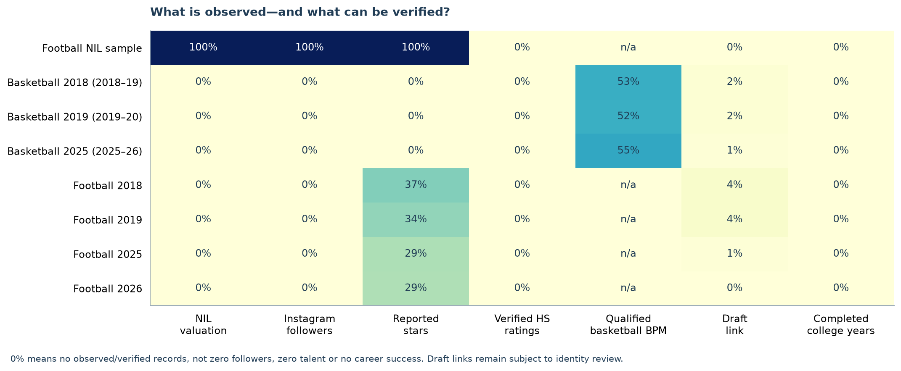
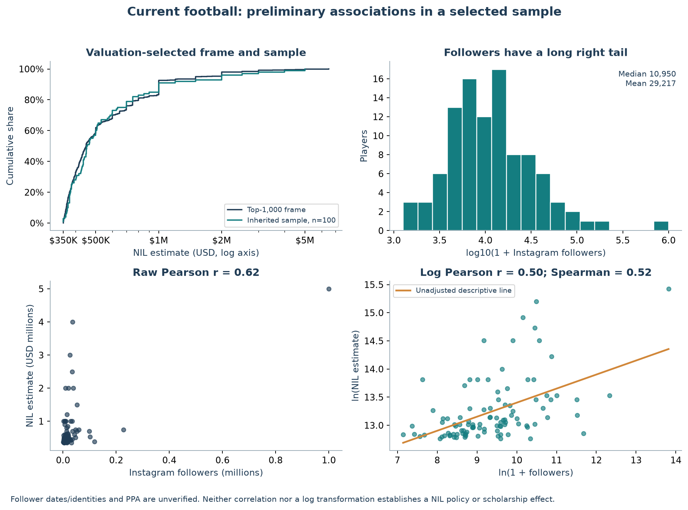
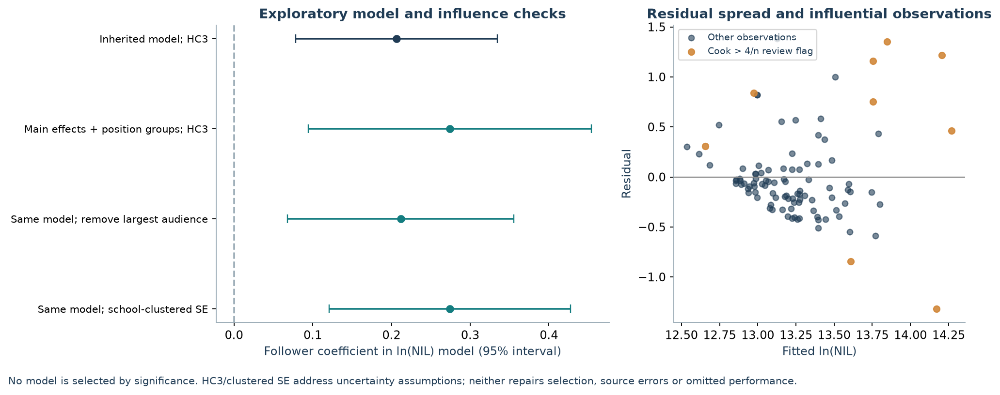
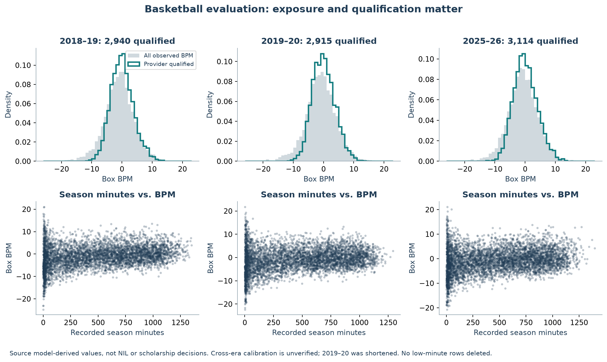
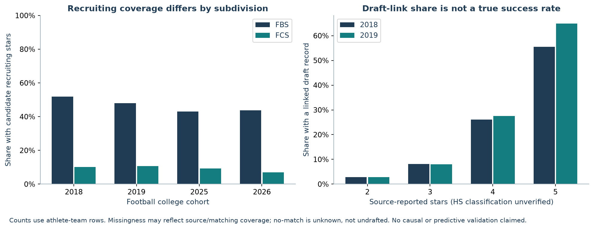
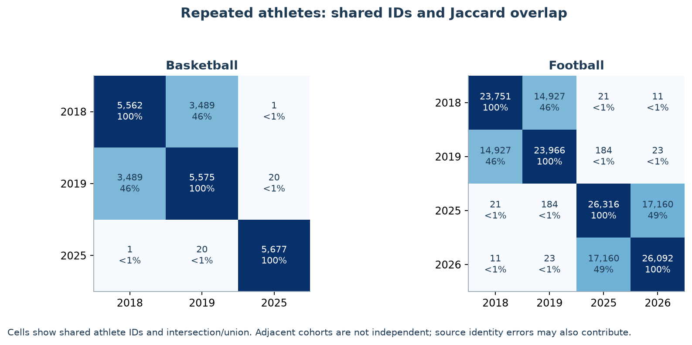

# Exploratory data analysis

Exploratory snapshot of the available source layers; no new source collection, confirmatory hypothesis test or NIL policy-effect claim. This report distinguishes a current valuation association from the still-unanswered scholarship/pre-post question. Player-level outputs stay local; code, aggregate tables and figures are reviewable.

Source layers: inherited football CSVs attributed to The Sideline by the partner write-up (original snapshot and valuation type unverified), ESPN/SportsDataverse performance and roster exports, SportsDataverse model-derived basketball BPM, and nflverse career crosswalks. Exact input hashes are in the manifest; collection provenance is in the existing source audits. NIL figures are estimates, not verified compensation.

## Main findings

- Only the inherited football model file has both NIL and followers (n=100); it is drawn from a top-1,000 valuation frame, not the full college-athlete population. Historical and basketball layers have no social measurements or NIL valuations. Verified HS recruiting is absent in the new frames.
- Current football followers are highly skewed: median 10,950, mean 29,217, maximum 1,000,000. The largest account contributes 34.2% of summed followers in this sample.
- The selected-sample association is positive: raw Pearson r=0.623, log-scale Pearson r=0.502, Spearman rho=0.520. Removing the largest account changes raw r to 0.164 and log r to 0.403. These are descriptive, not causal or independent validation of the input observations.
- Conference variation is nearly absent (99/100 Power-4); 70/100 have four-star labels. There are 39 schools, with repeated players per school. Avoid treating the Power-4 coefficient as a stable conference effect.
- PPA needs recollection: 41 zeros and 30 nonzero values on defense/offensive line, where this collected offensive metric is not applicable. These are audit flags, not proof of exact row corrections.
- Football recruiting availability is selective: in 2018, 52.0% of FBS rows versus 10.1% of FCS rows have candidate stars. Complete-case restriction would change the target population. These are not yet verified high-school ratings.
- Basketball BPM is broadly observed, but roughly half of roster rows satisfy the provider qualification flag. Unqualified/low-minute rows have wider extremes. Compare exposure and source qualification before ranking players.
- Adjacent seasons reuse many athlete IDs; player-team rows, distinct athletes, and sampling units differ. Historical cohorts have much longer career follow-up. Draft no-match remains unknown, so observed link shares are not draft probabilities.

## Data structure and coverage

| dataset | rows | unique_athletes | schools | multi_team_athletes |
| --- | --- | --- | --- | --- |
| football_NIL_model | 100 | 100 | 39 | 0 |
| basketball_2018 | 5590 | 5562 | 353 | 28 |
| basketball_2019 | 5587 | 5575 | 353 | 12 |
| basketball_2025 | 5680 | 5677 | 365 | 3 |
| football_2018 | 23755 | 23751 | 216 | 4 |
| football_2019 | 23985 | 23966 | 217 | 19 |
| football_2025 | 26327 | 26316 | 234 | 11 |
| football_2026 | 26094 | 26092 | 235 | 2 |

The three inherited football files are nested layers (frame → sampled players → enriched/model records), not three independent samples. The seven cohort files are supporting source frames, not final stratified samples or proof of complete national coverage. Football school coverage changes across years, so a change in source population can mimic a trend. Superseded production samples are intentionally excluded. Basketball cohort starts 2018/2019/2025 mean 2018–19/2019–20/2025–26; football uses fall-start seasons. Fall 2026 is ongoing.



All-zero verification coverage differs from an observed numerical zero. The field dictionary records absent columns, missing observations, uniqueness and suggested roles. The cohort files currently lack the social columns entirely, rather than containing verified zero followers.

## Current football: distributions and preliminary relationships



The top-1,000 frame has only 235 distinct reported valuations, so ties and rounded price bands matter. The sample minimum of $350,000 reflects valuation selection. Modeling only this range cannot identify scholarship selection or associations for lower-valued/unvalued athletes. Sampling weights target the supplied frame; they cannot recover athletes excluded below the cutoff.

## Exploratory model checks

| model | n | social_coefficient | ci95_low | ci95_high | r_squared |
| --- | --- | --- | --- | --- | --- |
| Inherited model; HC3 | 100 | 0.207 | 0.079 | 0.335 | 0.321 |
| Main effects + position groups; HC3 | 100 | 0.274 | 0.094 | 0.454 | 0.355 |
| Same model; remove largest audience | 99 | 0.212 | 0.068 | 0.355 | 0.306 |
| Same model; school-clustered SE | 100 | 0.274 | 0.121 | 0.427 | 0.355 |

The inherited model is retained only as a replication benchmark. The alternative omits unverified PPA and the nearly constant Power-4 indicator, includes both main effects for the stars×freshman interaction, and groups positions to avoid sparse single-position cells. It still lacks a validated college-performance control. The largest-audience deletion is a sensitivity check, not a new preferred sample. No model is chosen by its p-value or R².



The alternative model has 9 observations above the descriptive Cook's-distance 4/n flag. Leave-one-out follower slopes range from 0.212 to 0.314. Flags prompt review rather than automatic deletion. The school-clustered calculation uses 39 clusters and a small-sample correction; sparse/unbalanced clusters still limit precision.

HC3 and cluster covariance calculations follow [statsmodels robust covariance documentation](https://www.statsmodels.org/stable/generated/statsmodels.regression.linear_model.RegressionResults.get_robustcov_results.html). These change uncertainty estimates; they do not repair input validity, outcome-based selection, reverse causation or confounding. Influence/residual checks follow [statsmodels diagnostics](https://www.statsmodels.org/stable/examples/notebooks/generated/regression_diagnostics.html).

## Basketball: comparable exposure before comparable outcomes

| cohort_start | rows | BPM_available | BPM_qualified | median_games | median_PPG | median_BPM_qualified |
| --- | --- | --- | --- | --- | --- | --- |
| 2018 | 5590 | 4762 | 2940 | 29.000 | 4.646 | -0.143 |
| 2019 | 5587 | 4768 | 2915 | 28.000 | 4.704 | -0.179 |
| 2025 | 5680 | 5015 | 3114 | 29.000 | 5.150 | -0.183 |

| cohort_start | qualified_PPG_BPM_spearman | between_school_BPM_variance_share |
| --- | --- | --- |
| 2018 | 0.155 | 0.542 |
| 2019 | 0.162 | 0.523 |
| 2025 | 0.119 | 0.648 |

Among provider-qualified players, the descriptive between-school share of BPM variation is about 52–65%, and PPG/BPM rank correlation is only about .12–.16. This is compatible with a measure that captures substantial team context rather than scoring alone; it is not validation of player ability. Review construction/calibration before using BPM as a replacement evaluation outcome. The variance decomposition is descriptive, not a causal school effect.



Source BPM combines model-derived efficiency information and is not NIL valuation, scholarship evaluation or a prospective real-time ranking. Differences across seasons may reflect exposure, population, model calibration and source coverage. Game medians use rows with at least one recorded appearance; PPG summaries use nonmissing observations. The 2019–20 season has fewer recorded games; season point totals should not be compared as though opportunities were equal. Qualification/minutes restrictions change the estimand to qualifying/active players, so retain the full frame and report exclusions. Do not infer the effect of NIL from a shift in these distributions.

## Football: missingness and draft ascertainment



| dataset | rows | draft_links | no_matched_draft_record | identity_timing_flags |
| --- | --- | --- | --- | --- |
| basketball_2018 | 5590 | 91 | 5499 | — |
| basketball_2019 | 5587 | 89 | 5498 | — |
| basketball_2025 | 5680 | 45 | 5635 | — |
| football_2018 | 23755 | 1028 | 22727 | 10.000 |
| football_2019 | 23985 | 1039 | 22946 | 9.000 |
| football_2025 | 26327 | 256 | 26071 | 6.000 |
| football_2026 | 26094 | 0 | 26094 | 1.000 |

Many basketball draft links have a secondary-source disagreement flag; the draft coverage CSV records those counts separately from ID-supported football links. Resolve these disagreements before outcome modeling.

The plotted higher-star draft-link pattern is descriptive and mixes unverified ratings, differential identity coverage and subsequent opportunities. Unmatched players may be drafted under another identity/school, undrafted, still eligible, playing abroad, or simply missing. No binary success/failure or logistic regression was constructed from these unknowns. Career duration is not the number of source seasons observed, and a pro registry entry is not a contract.

## Dependence, repeated athletes and follow-up

| sport | cohort_a | cohort_b | shared_athletes | jaccard | share_of_first |
| --- | --- | --- | --- | --- | --- |
| basketball | 2018 | 2019 | 3489 | 0.456 | 0.627 |
| football | 2018 | 2019 | 14927 | 0.455 | 0.628 |



Use a documented athlete-season or athlete-school-decision unit. For transfers, retain team records for source audit and define one athlete-season measurement before modeling, rather than arbitrarily duplicating the outcome. Repeated athletes require dependence-aware inference; school clustering may also matter. Train/test splits, if prediction becomes a goal, must group by athlete and respect chronology. Do not compare eight years of historical career follow-up with incomplete current careers.

## Analysis plan supported by this EDA

1. **Available now: selected-sample valuation association.** After validating follower identities/dates and recollecting performance, use ln(NIL) against ln(1+followers), with justified baseline stars, experience and position controls. This log-outcome model describes positive valuations; pre-specify how genuine zero valuations will be handled in future frames, without turning unknown valuations into zeros or silently excluding source-reported zeros. Include constituent main effects for interactions. Inspect nonlinear patterns and influential cases; report HC3 plus a school-cluster sensitivity. Effects are associations within the defined valuation frame. The current 100 observations and limited covariate variation constrain complexity.
2. **Basketball/cross-sport NIL extension: pending inputs.** Obtain the real NIL frame, apply the pre-specified 250-per-quartile sample before enrichment, collect contemporaneous followers and verify covariates. Then compare social slopes with a pooled social×sport interaction and its confidence interval. Harmonize measurement timing and inclusion criteria; do not compare raw PPA and BPM as the same scale. Neither separately significant slopes nor different signs establish a slope difference.
3. **Original before/after scholarship question: not estimable yet.** Define a common outcome (verified offers/award or another explicitly redesigned evaluation measure), dated predictors and a consistent eligible population in both eras. The present historical frames have neither social counts nor scholarship decisions. Current NIL-selected and historical recruiting-selected samples target different populations and cannot simply be pooled. Pre-specify a common sampling frame/weights and timing policy. A social×post interaction estimates a change in association, not automatically a causal effect of NIL; calendar/platform/COVID/policy changes remain confounded.
4. **Career evaluation alternative: redesign before fitting.** Keep draft/contract outcomes separate; establish verified positives, trustworthy negatives and a common follow-up horizon or a censoring-aware design. Draft round is conditional on draft selection and differs by league. An ordinal/selection or time-to-event model may be justified after the observation process is resolved; do not assign undrafted players round zero. Years in college has no monotonic quality interpretation.
5. **Finish coverage and power before adding complexity.** Verify HS classes, preserve missingness and map source/identity failures by sport, tier, position and subdivision. Do not impute structural missingness such as nonexistent historical NIL values or unknown future outcomes. Use the existing partial-term power script for the planned interaction and revise for clustering/design. Pre-specify the primary model before collecting/inspecting further effect estimates.

The field dictionary tags later career outcomes and source metadata so they are not accidentally treated as pre-decision predictors. Also verify whether valuation estimates already use the proposed predictors; formula-generated outcomes can build associations into the data.

## Reproduction and artifacts

```bash
python scripts/run_eda.py
```

Tables/figures: `reports/eda/`. Standalone visual report: `outputs/eda-20261101/eda_report.html`. Private influence rows: `Data/private/eda/`. Input hashes, software versions and exclusions: `reports/eda/manifest.json`. Raw and enriched inputs are read-only; no live requests or synthetic observations enter the EDA. All intervals and sensitivity fits are exploratory.
